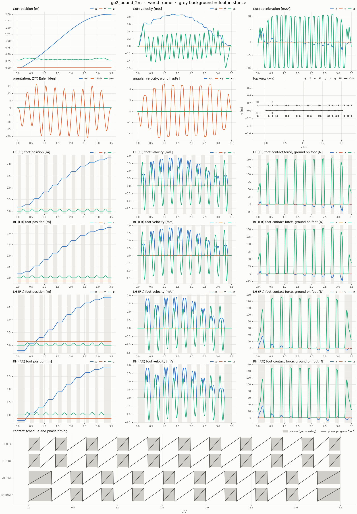
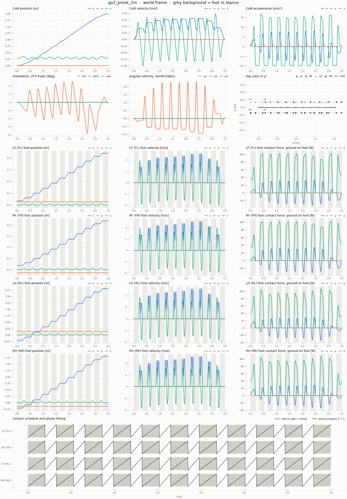
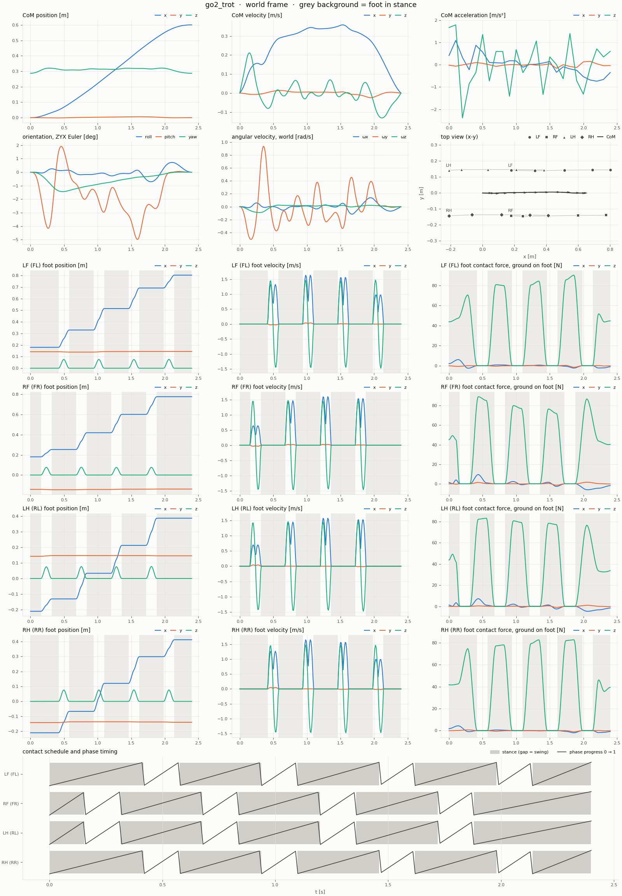

# TOWR for the Unitree Go2: High-Level Guide

How TOWR works, which knobs shape the trajectory, and how to get Go2 motions out of it.

A working Go2 program sits next to this file in [`go2_example/`](go2_example/). It is built and tested
against the TOWR install in this repo. Every number in this guide comes from that program or
from `urdfs/go2_description`.

---

## 1. Mental model in one paragraph

You describe **what** should happen: the robot model, the terrain, the start pose, the goal pose,
the total time, and **which foot touches the ground when** (the contact schedule). TOWR turns this
into one big nonlinear optimization problem (NLP), and IPOPT finds **how** to do it: the body (CoM)
path, its orientation, every foot path, and every contact force, all physically consistent.
TOWR does **not** output joint angles or torques. It plans in task space, and you convert that
to joint commands afterwards (section 11).

```
           YOU PROVIDE                                   TOWR + IPOPT FIND
 ┌───────────────────────────────┐               ┌────────────────────────────────────┐
 │ robot model (box + mass/inert)│               │ base CoM position  x,y,z (t)        │
 │ terrain height map            │   NLP solve   │ base orientation   roll,pitch,yaw(t)│
 │ initial base pose + feet      │ ────────────▶ │ foot position      p_i(t)  i=0..3   │
 │ goal base pose                │   (~0.5-1 s)  │ contact force      f_i(t)  i=0..3   │
 │ contact schedule + total time │               │ (optional) step timings             │
 └───────────────────────────────┘               └────────────────────────────────────┘
```

### The robot as TOWR sees it

- **Body**: one rigid body with total mass `m` and inertia `I` (Single Rigid Body Dynamics, SRBD).
  The legs are treated as massless.
- **Feet**: points. Each foot must stay inside a **box** around its nominal position, expressed
  in the body frame. This box is the entire kinematic model: no joints, no joint limits.
- **Contacts**: a foot in stance stays still and may push (unilateral force, inside a friction
  pyramid). A foot in swing moves and has zero force.

---

## 2. The five inputs (`towr::NlpFormulation` fields)

Everything you set lives in one struct (`include/towr/nlp_formulation.h`):

| Field | Type | What it means |
|---|---|---|
| `model_` | `RobotModel` | `kinematic_model_` (nominal feet + box size) and `dynamic_model_` (mass, inertia) |
| `terrain_` | `HeightMap::Ptr` | ground height `h(x,y)`, its slopes, and the friction coefficient |
| `initial_base_` | `BaseState` | start CoM pos/vel (`.lin`) and Euler angles/rates (`.ang`) |
| `initial_ee_W_` | `vector<Vector3d>` | start foot positions **in the world frame**, one per leg |
| `final_base_` | `BaseState` | goal CoM pos/vel and Euler angles/rates |
| `params_` | `Parameters` | contact schedule, active constraints, costs, discretization |

The solve loop is always the same (from `test/hopper_example.cc`):

```cpp
ifopt::Problem nlp;
towr::SplineHolder solution;                       // filled with live splines
for (auto v : formulation.GetVariableSets(solution)) nlp.AddVariableSet(v);
for (auto c : formulation.GetConstraints(solution))  nlp.AddConstraintSet(c);
for (auto c : formulation.GetCosts())                nlp.AddCostSet(c);
// your own constraints/costs: nlp.AddConstraintSet(my_constraint);

auto solver = std::make_shared<ifopt::IpoptSolver>();
solver->SetOption("jacobian_approximation", "exact");
solver->Solve(nlp);

// query any time t:
solution.base_linear_->GetPoint(t).p();            // CoM position  (.v() vel, .a() acc)
solution.base_angular_->GetPoint(t).p();           // roll, pitch, yaw [rad] (ZYX Euler)
solution.ee_motion_.at(leg)->GetPoint(t).p();      // foot position, world frame
solution.ee_force_.at(leg)->GetPoint(t).p();       // ground reaction force on the foot [N]
solution.phase_durations_.at(leg)->IsContactPhase(t);
```

---

## 3. The optimization problem TOWR builds

### Variables (what IPOPT changes)

| Variable set | Parameterization |
|---|---|
| `base-lin`, `base-ang` | Cubic Hermite splines. One polynomial every `duration_base_polynomial_` (0.1 s) |
| `ee-motion_i` | **Phase-based.** During stance the foot is one constant node. During swing it has `ee_polynomials_per_swing_phase_` (2) polynomials |
| `ee-force_i` | **Phase-based.** During stance it has `force_polynomials_per_stance_phase_` (3) polynomials. During swing it is fixed to zero |
| `ee-schedule_i` | Phase durations. Optimized only if `params_.OptimizePhaseDurations()` is called |

Phase-based means the contact schedule is built into the variables. A foot cannot slip during
stance or push during swing, because the parameterization has no way to express it. So the
contact schedule is the most important choice you make (section 4).

### Constraints (default set in `Parameters()`)

| Enum | Class | Enforces | Main knob |
|---|---|---|---|
| `Dynamic` | `DynamicConstraint` | Newton-Euler of the rigid body: `m·a = Σf + m·g`, `I·ω̇ + ω×Iω = Σ (p_i − c)×f_i` | `dt_constraint_dynamic_` (0.1 s) |
| `EndeffectorRom` | `RangeOfMotionConstraint` | each foot stays inside its box around nominal (body frame) | `max_dev_from_nominal_`, `dt_constraint_range_of_motion_` (0.08 s) |
| `Terrain` | `TerrainConstraint` | stance feet sit on the ground, swing nodes are above it | `terrain_` |
| `Force` | `ForceConstraint` | normal force in `[0, force_limit]`, friction pyramid with `μ` | `force_limit_in_normal_direction_`, `friction_coeff_` |
| `Swing` | `SwingConstraint` | the mid-swing node sits halfway in xy, so steps look smooth | requires 2 polys per swing |
| `BaseAcc` | `SplineAccConstraint` | base acceleration stays continuous between polynomials | – |
| `BaseRom` *(off)* | `BaseMotionConstraint` | roll and pitch within ±0.05 rad, z within [z₀−0.02, z₀+0.10] (hard-coded) | edit `src/base_motion_constraint.cc` |
| `TotalTime` *(off)* | `TotalDurationConstraint` | phase durations sum to T. Added by `OptimizePhaseDurations()` | `bound_phase_duration_` |

Start and goal are **variable bounds**, not constraints:
- Start: CoM pos and vel, Euler angles and rates, and every foot position are fixed.
- Goal: only the dimensions listed in `bounds_final_lin_pos_` (default `{X,Y}`, so **final height is
  free**), `bounds_final_lin_vel_` (`{X,Y,Z}`), `bounds_final_ang_pos_` and `bounds_final_ang_vel_`
  (both `{X,Y,Z}`) are fixed.

### Costs

None by default. TOWR only looks for a feasible motion. Two cost terms exist
(`Parameters::ForcesCostID`, `EEMotionCostID`). Before using them, read gotcha #3 in section 10.

---

## 4. The contact schedule: your main design lever

Per leg you give a list of phase durations that alternate stance and swing, plus a flag for
whether the leg starts in stance:

```cpp
// leg 0 (LF): stance 0.5, swing 0.3, stance 0.4, swing 0.3, stance 0.5   -> total 2.0 s
params.ee_phase_durations_.push_back({0.5, 0.3, 0.4, 0.3, 0.5});
params.ee_in_contact_at_start_.push_back(true);
// ... same for legs 1..3. EVERY leg's durations must sum to the SAME total T.
```

- The **number** of phases is fixed. The optimizer can only change durations, and only with
  `OptimizePhaseDurations()`.
- The total time `T` is the sum of the durations.
- Too few steps for the distance means "no solution". Too many steps is rarely a problem.

### `GaitGenerator`: preset schedules

Writing schedules by hand gets tedious, so use `GaitGenerator`. You chain **strides**, and it
scales the whole sequence to your `T`:

```cpp
auto gait = towr::GaitGenerator::MakeGaitGenerator(4);
gait->SetGaits({G::Stand, G::Run1, G::Run1, G::Run1, G::Run1, G::Stand});   // or SetCombo(C1)
for (int ee = 0; ee < 4; ++ee) {
  params.ee_phase_durations_.push_back(gait->GetPhaseDurations(T, ee)); // scaled to T
  params.ee_in_contact_at_start_.push_back(gait->IsInContactAtStart(ee));
}
```

Quadruped strides (`src/quadruped_gait_generator.cc`). Raw times are shown before scaling to `T`:

| Enum | Gait | Pattern (stance legs) | Raw stride time |
|---|---|---|---|
| `Stand` | stand | all 4 | 0.3 s |
| `Flight` | *(misnamed)* 3-leg stance, **LF lifted** | LH RH RF | 0.3 s |
| `Walk1` | static walk, one leg at a time with 4-leg pauses | LH→LF→RH→RF | 2.0 s |
| `Walk2` / `Walk2E` | overlapping walk (2–3 legs down) | lateral sequence | 1.52 s |
| `Run1` | **trot without flight** | LF+RH ↔ RF+LH, 4-leg pause between | 1.0 s |
| `Run2` / `Run2E` | flying trot | diagonal pairs, 0.1 s full flight | 1.0 s |
| `Run3` / `Run3E` | pace | left pair ↔ right pair, flight | 0.8 s |
| `Hop1` / `Hop1E` | bound | hind pair ↔ front pair, flight | 0.8 s |
| `Hop2` | pronk | all 4 → flight 0.4 s → all 4 | 1.0 s |
| `Hop3` / `Hop3E` | gallop | front pair then hind pair, 1–3 legs down | 1.8 s |
| `Hop5` | limp | 3 legs → all 4 → LF only | 0.8 s |

- `…E` = the same stride without its final transition. Put it last before `Stand` so the
  gait closes cleanly.
- `SetCombo`: `C0` overlap-walk, `C1` flying trot, `C2` pace, `C3` bound, `C4` gallop. Each is
  `Stand + 3 strides + E-stride + Stand`.
- `Hop5E` is in the enum but not implemented, so it triggers `assert`.

---

## 5. The Go2 model

TOWR ships only Monoped, Biped, HyQ, and ANYmal models. For a new robot you **add** two classes
and change nothing in TOWR (`go2_example/go2_motion.cc:57-92`):

```cpp
class Go2KinematicModel : public towr::KinematicModel {        // feet + box
  Go2KinematicModel() : KinematicModel(4) {
    nominal_stance_.at(LF) <<  0.18,  0.142, -0.287;           // relative to CoM [m]
    nominal_stance_.at(RF) <<  0.18, -0.142, -0.287;
    nominal_stance_.at(LH) << -0.21,  0.142, -0.287;
    nominal_stance_.at(RH) << -0.21, -0.142, -0.287;
    max_dev_from_nominal_  << 0.10, 0.08, 0.07;               // box half-size
  }
};
class Go2DynamicModel : public towr::SingleRigidBodyDynamics {
  Go2DynamicModel() : SingleRigidBodyDynamics(15.2, CompositeInertia(), 4) {}
  // I = [0.188 0 -0.020; 0 0.499 0; -0.020 0 0.532] kg·m²
};
```

### Where the numbers come from

`go2_example/go2_srbd_from_urdf.py` reads `urdfs/go2_description/urdf/go2_description.urdf`, runs
forward kinematics at a standing pose (thigh 0.8 rad, calf −1.5 rad), and sums all 15 bodies:

```
$ python3 go2_srbd_from_urdf.py ../../../urdfs/go2_description/urdf/go2_description.urdf 0.8 -1.5
(abbreviated)
total mass       : 15.206 kg
CoM in base frame: [-0.0019  0.  -0.0246]
composite inertia about CoM: diag ≈ [0.188, 0.499, 0.532], Ixz ≈ -0.020
FL_foot rel. CoM: [ 0.1797  0.142  -0.2867]   RL_foot rel. CoM: [-0.2071  0.142  -0.2867]
```

To get a lower or higher stance, rerun the script with other joint angles and paste the new
values.

**`max_dev_from_nominal_` is a guess.** It was picked so that the leg (thigh = calf = 0.213 m) can
reach every corner of the box. Check it against your IK and joint limits. Too small and long
steps fail. Too large and TOWR plans feet the real leg cannot reach.

### Leg order and frames

| TOWR index | TOWR name | Go2 URDF | Unitree SDK leg index (verify for your stack) |
|---|---|---|---|
| 0 | `LF` | `FL` | 1 |
| 1 | `RF` | `FR` | 0 |
| 2 | `LH` | `RL` | 3 |
| 3 | `RH` | `RR` | 2 |

- TOWR's "base" is the **CoM**, not the URDF `base` link. In the standing pose the CoM sits at
  `(-0.002, 0, -0.025)` in the base-link frame, so `p_base_link = p_com + R·(0.002, 0, 0.025)`.
- Orientation is ZYX Euler, stored as `(roll, pitch, yaw)` in `(X, Y, Z)`.
- Feet and forces are in the **world** frame. The force is the ground reaction force, the
  force the ground pushes *on* the robot.

---

## 6. The example program

```
go2_example/
├── CMakeLists.txt            find_package(towr) + ifopt, Release by default
├── go2_motion.cc             Go2 model + gait presets + swing-height + sagittal constraints + CSV export
├── go2_srbd_from_urdf.py     URDF → mass / inertia / nominal feet
├── plot_trajectory.py        CSVs → one PNG (base, each foot, gait timing)
├── towr_to_planar.py         (yours) sample CSV → planar tracker CSV with IK, joint rates, torques
├── towr_to_3d.py             sample CSV → 3D tracker CSV (3D leg IK, torques, Go2 limit check); any gait
├── smooth_flight_legs.py     planar CSV: redraw in-air leg motion within joint speed limits (§6 jumps)
├── plots/trot.png
└── trajectories/
    ├── go2_bound_2m.{csv,_phases.csv,_planar.csv,png}    2 m sagittal bound, μ = 0.8 (§6)
    ├── go2_pronk_2m.{csv,_phases.csv,_planar.csv,png}    2 m sagittal pronk, μ = 0.8 (§6)
    ├── go2_jump_1.2m.{csv,_phases.csv,_planar.csv,png}   3 forward jumps, +14 cm, within Go2 limits
    ├── go2_jump_2m.{csv,_phases.csv,_planar.csv,png}     4 forward jumps, +11 cm, within Go2 limits
    ├── go2_trot_side_0.5m.{csv,_phases.csv,_3d.csv,png}     3D: side-step trot 0.5 m left (§6 3D)
    ├── go2_bound_1.5m_yaw0.3.{csv,_phases.csv,_3d.csv,png}  3D: bound 1.5 m turning 17°
    └── go2_pronk_diag.{csv,_phases.csv,_3d.csv,png}         3D: pronk to (0.6, 0.3) m, 17°
        (_planar.csv = towr_to_planar.py output: 1 ms grid, base + joint angles/rates/torques, pair forces;
         for the jumps, in-air leg motion redrawn by smooth_flight_legs.py.
         _3d.csv = towr_to_3d.py output: the same per leg and in 3D. forceStance reads both.)
```

### Build and run

```bash
cd go2_example && mkdir -p build && cd build
cmake .. && make
./go2_motion                                  # default: trot 0.6 m forward in 2.4 s
./go2_motion <gait> <x> <y> <yaw> <T> [apex_min apex_max]
./go2_motion walk 0.6 0 0 4.0                 # walk
./go2_motion trot 0 0 1.57 2.4                # turn 90° in place
./go2_motion trot 0 0.3 0 2.4                 # side-step 30 cm left
./go2_motion trot 0.6 0 0 2.4 0 0             # disable the swing-height limit
python3 ../plot_trajectory.py go2_trot.csv                        # open window
python3 ../plot_trajectory.py go2_trot.csv --save plots/trot.png  # write PNG

# 2 m sagittal-plane bound with friction 0.8 (the file in trajectories/), ~33 s solve
./go2_motion bound 2.0 0 0 3.5 0.04 0.10 --strides 10 --sagittal --mu 0.8 \
    --dt-dyn 0.01 --base-poly 0.01 --max-cpu 120 --sample-dt 0.002 --out go2_bound_2m
```

`<gait>` ∈ `walk trot flytrot pace bound gallop pronk jump`. Optional flags, which can go anywhere:

| Flag | Effect |
|---|---|
| `--strides N` | number of strides between the start and end stands (default 4, pronk 3); for `jump`, the number of jumps |
| `--flight S --stance S` | `jump` only: time in the air and on the ground per jump (defaults 0.45 / 0.3). The rest of `T` goes to the first crouch and the final landing |
| `--ramp-from S` | `jump` only: solve with flight S first, then grow it in 0.03 s steps to `--flight`, warm-starting each solve (needed for big jumps). Requires `--base-poly` |
| `--ramp-x-from X` | with `--ramp-from`: do the flight ramp at forward distance X, then grow the goal to the target in 0.1 m steps of x. y and yaw scale in proportion, so a diagonal or turning jump keeps its direction (long jumps) |
| `--sagittal` | pure x-z plane motion: body y, roll, and yaw held at 0, right legs mirror left legs (positions and forces). Only for gaits where left and right move together: `bound`, `pronk`, `jump` |
| `--dense-force` | check push-only, friction, and force limit every `dt-dyn`, not only at force spline points |
| `--foot-z MIN MAX` | how far below the CoM a foot may be (default 0.217 0.357). Smaller MIN = deeper crouch; smaller MAX = bent knee at take-off |
| `--foot-x DX` | ± fore/aft foot reach around nominal (default 0.10). Smaller = shorter thigh lever = less thigh torque |
| `--swing-polys N` | spline pieces per swing (default 2; >2 drops TOWR's swing constraint, needs apex `0 0`) |
| `--force-polys N` | spline pieces per stance force (default 3) |
| `--dt-dyn S --base-poly S` | physics check interval and body spline segment length. **Use the same value for both** (§9) |
| `--max-cpu S` | IPOPT time limit (default 30 s). Fine grids need more |
| `--sample-dt S` | CSV row spacing (default 0.01 s) |
| `--mu X` | ground friction coefficient (default 0.5, TOWR's value) |
| `--out PREFIX` | output file prefix (default `go2_<gait>`) |

Each run writes two files.

**`go2_<gait>.csv`**: one row every `--sample-dt`, the last row exactly at `T`. All values are in the world frame.

| Columns | Meaning | Units |
|---|---|---|
| `t` | time | s |
| `com_x, com_y, com_z` | CoM position | m |
| `com_vx, com_vy, com_vz` | CoM velocity | m/s |
| `com_ax, com_ay, com_az` | CoM acceleration (piecewise linear, because the splines are cubic) | m/s² |
| `roll, pitch, yaw` | Euler angles, ZYX convention | rad |
| `qw, qx, qy, qz` | the same orientation as a quaternion, base → world | – |
| `wx, wy, wz` | angular velocity (true ω, not Euler rates) | rad/s |
| `<L>_px, _py, _pz` | foot position, `L` ∈ `LF RF LH RH` | m |
| `<L>_vx, _vy, _vz` | foot velocity (exactly 0 in stance) | m/s |
| `<L>_fx, _fy, _fz` | contact force from the ground on the foot (exactly 0 in swing) | N |
| `<L>_contact` | 1 = stance, 0 = swing | – |
| `<L>_phase` | index of the current phase for this leg (0, 1, 2, …) | – |
| `<L>_phase_progress` | 0 at phase start → 1 at phase end | – |

**`go2_<gait>_phases.csv`**: one row per stance or swing phase of each leg. This is the exact
timing, independent of `--sample-dt`.

| Columns | Meaning |
|---|---|
| `leg, phase, contact` | leg name, phase index, 1 = stance |
| `t_start, t_end, duration` | liftoff and touchdown times [s] |
| `start_x/y/z, end_x/y/z` | foot position at phase start and end. For a stance row this is the foothold |

Checks on a trot run:
- stance foot velocity is 0 and swing force is ~0
- quaternion and Euler angles agree to 1e-9
- `com_v` matches the time derivative of `com_x`
- `wz` matches the yaw rate

### `main` in a few lines

```cpp
auto params      = go2::MakeGaitParameters(go2::StridesFor("trot", /*strides=*/4), /*T=*/2.4); // WHEN feet touch
auto formulation = go2::MakeFormulation({/*x*/0.6, /*y*/0.0, /*yaw*/0.0}, params);           // robot, terrain, start, goal

// Extra constraints are factories: some (e.g. sagittal dynamics) need the splines, which exist
// only once the solver builds the variables.
std::vector<go2::ConstraintFactory> extra = {
  [t = formulation.terrain_](const towr::SplineHolder&) { return go2::MakeSwingHeightConstraints(t, {0.06, 0.10}); },
};
// sagittal: formulation built from go2::WithoutTowrDynamics(params), then
// extra.push_back(go2::MakeSagittalConstraints(formulation, 1e-6));
auto solution = go2::Solve(formulation, extra, /*max_cpu=*/30.0);                             // IPOPT

auto schedules = go2::ExtractContactPhases(solution.splines);              // exact phase timing
auto samples   = go2::SampleTrajectory(solution.splines, schedules, 0.01); // pure, no I/O
go2::WriteSamplesCsv(samples, samples_csv);
go2::WritePhasesCsv(schedules, phases_csv);
```

`SampleTrajectory` returns `std::vector<TrajectorySample>`, so a C++ tracker can use the
samples directly instead of reading the CSV.

### Tested results (this machine, Release, swing apex limited to 6–10 cm)

| Command | Solved | Time | Max foot force | Max foot height |
|---|---|---|---|---|
| `trot 0.6 0 0 2.4` | ✅ | 0.5 s | 90 N | 0.077 m |
| `walk 0.6 0 0 4.0` | ✅ | 1.1 s | 99 N | 0.095 m |
| `flytrot 0.8 0 0 2.4` | ✅ | 0.8 s | 175 N | 0.100 m |
| `pace 0.6 0 0 2.4` | ✅ | 0.7 s | 211 N | 0.098 m |
| `bound 0.6 0 0 2.4` | ✅ | 1.1 s | 249 N | 0.081 m |
| `gallop 0.8 0 0 2.4` | ✅ | 0.6 s | 122 N | 0.082 m |
| `pronk 0.4 0 0 2.4` | ✅ | **10.4 s** | 194 N | 0.096 m |
| `trot 0 0 1.57 2.4` (turn) | ✅ | 0.5 s | 90 N | 0.063 m |
| `trot 0 0.3 0 2.4` (side) | ✅ | 0.5 s | 84 N | 0.073 m |
| `trot 0.4 0.2 0.5 2.4` | ✅ | 0.6 s | 133 N | 0.080 m |
| `trot 0.6 0 0 2.4 0 0` (no apex limit) | ✅ | 0.7 s | 84 N | **0.191 m** |

Go2 weighs about 149 N, so a trot puts about 75 N on each stance foot. That matches the result.

### Sagittal bound, 2 m (`trajectories/go2_bound_2m.*`)

The command is in "Build and run" above: 10 bound strides in 3.5 s, `--sagittal`, friction μ = 0.8,
a 0.01 s physics grid, and 2 ms output (1751 rows). Verified on the output, every 2 ms:

| Check | Result |
|---|---|
| roll, yaw, body y, ωx, ωz | all < 1e-16 (exactly zero) |
| left vs right leg (x, z position and force) | identical (< 1e-19) |
| start → goal | x 0 → 2.000 m, height 0.287 → 0.287 m |
| pitch | −20.7° … +16.5° (the sagittal motion of a bound) |
| CoM height | 0.286 … 0.365 m; speed peak 0.87 m/s, average 0.57 m/s |
| timing | 0.13 s stance per pair, 18 flight phases of 0.043 s each |
| contact force | ≤ 156 N per foot (limit 350); foot apex ≤ 0.10 m; max \|fx\|/fz 0.37 (limit 0.8) |
| physics error **between** check points | vertical force 9.5 N max / 3.0 N RMS (2% of weight), forward 1.4 N, pitch moment 2.0 Nm max (peak contact moment 61 Nm) |
| joint limits (after `towr_to_planar.py` IK) | calf passes the URDF limit −0.838 rad by up to 0.7° for ~12 ms at the first push-off of each pair; the foot box allows a nearly straight leg |

During flight the vertical CoM acceleration sits exactly at −9.81 m/s², which is free fall.
For a 2D (x-z) model use base `com_x, com_z, pitch`, front foot = `LF` (= `RF`), and hind foot = `LH` (= `RH`).
Each 2D leg carries **2×** the per-foot force (`2·LF_fx`, `2·LF_fz`).

**Friction:** the same bound at TOWR's default μ = 0.5 used at most |fx|/fz = 0.36, so friction
never limits this motion. The μ = 0.5 and μ = 0.8 plans differ by ≤ 5 mm, 0.3°, and 1.2 N. A low μ
does bind: with `--mu 0.15` the ratio caps at 0.148. TOWR uses a friction pyramid
(|fx| ≤ μ·fz and |fy| ≤ μ·fz separately). With fy = 0, as here, that is exactly the friction cone.



### Sagittal pronk, 2 m (`trajectories/go2_pronk_2m.*`)

```bash
./go2_motion pronk 2.0 0 0 3.5 0.04 0.10 --strides 10 --sagittal --mu 0.8 \
    --dt-dyn 0.01 --base-poly 0.01 --max-cpu 180 --sample-dt 0.002 --out go2_pronk_2m   # ~22 s
```

There are 10 hops of 0.2 m, and all four feet share the same contact timing. Each hop is 0.198 s
of stance and 0.132 s of flight. Choosing the settings: all 9 combinations of {6, 8, 10} hops ×
{3.0, 3.5, 4.0} s solved on a 0.025 s grid. 10 hops in 3.5 s had the flattest body and the lowest
forces. Avoid 6 hops in 4.0 s: there, friction is violated between force spline points
(|fx|/fz reaches 2.15).

| Check | Result |
|---|---|
| roll, yaw, body y | < 1e-16 (exactly zero); left/right mirror < 1e-18 |
| start → goal | x 0 → 2.000 m, height 0.287 → 0.287 m |
| pitch | −7.6° … +5.1° |
| CoM height | 0.246 … 0.351 m; speed peak 0.81 m/s |
| flight | CoM vertical acceleration exactly −9.81 m/s² (free fall) |
| contact force | ≤ 108 N per foot; max \|fx\|/fz 0.36 (limit 0.8); foot apex ≤ 0.087 m |
| physics error between check points | vertical 5.8 N max / 1.7 N RMS, forward 3.3 N, pitch moment 0.9 Nm (peak 32 Nm) |
| joints (`towr_to_planar.py` IK) | calf −1.88 … −1.04 rad, **within** the URDF limit. Per leg torque: thigh ≤ 8.6 Nm (limit 23.7), calf ≤ 20.5 Nm (limit 45.4) |



### Forward jumps within Go2 limits (`trajectories/go2_jump_*`)

```bash
# 3 jumps, 1.2 m, 0.33 s flight  (go2_jump_1.2m; ~1 min, 4 warm-started solves)
./go2_motion jump 1.2 0 0 2.65 0 0 --strides 3 --flight 0.33 --stance 0.33 --ramp-from 0.24 \
    --foot-z 0.13 0.31 --foot-x 0.06 --swing-polys 4 --sagittal --dense-force --mu 0.8 \
    --dt-dyn 0.01 --base-poly 0.01 --max-cpu 240 --sample-dt 0.002 --out go2_jump_1.2m
# 4 jumps, 2 m, 0.30 s flight    (go2_jump_2m)
./go2_motion jump 2.0 0 0 3.1 0 0 --strides 4 --flight 0.30 --stance 0.30 --ramp-from 0.24 \
    --foot-z 0.13 0.30 --foot-x 0.08 --swing-polys 4 --sagittal --dense-force --mu 0.8 \
    --dt-dyn 0.01 --base-poly 0.01 --max-cpu 240 --sample-dt 0.002 --out go2_jump_2m
python3 ../towr_to_planar.py go2_jump_2m.csv          # -> go2_jump_2m_planar.csv
python3 ../smooth_flight_legs.py go2_jump_2m_planar.csv  # redraw in-air legs in place; exit 1 if a limit is broken
```

| | `go2_jump_1.2m` | `go2_jump_2m` |
|---|---|---|
| jumps / distance / time | 3 / 1.2 m / 2.65 s | 4 / 2.0 m / 3.1 s |
| flight per jump | 0.33 s | 0.30 s |
| CoM peak above standing | **+13.8 cm** (crouch 0.13 m → peak 0.43 m) | +10.8 cm |
| contact force / friction | ≤ 200 N per foot, \|fx\|/fz ≤ 0.75 | ≤ 191 N, ≤ 0.63 |
| physics error | 1.8 N RMS | 1.6 N RMS |
| calf speed (limit 15.7 rad/s) | 13.2 | 12.7 |
| thigh speed (limit 30.1 rad/s) | 9.1 | 9.2 |
| thigh / calf torque per leg (limits 23.7 / 45.4 Nm) | 21.1 / 41.8 | 18.3 / 37.9 |
| joint angles | within URDF | within URDF |

Joint values are checked on the final `_planar.csv` over the whole trajectory, ground and air.
Roll, yaw, and body y are 0, and left/right are mirrored, as for the bound.

**What it took** (each item was a measured failure without it):
1. **A `jump` gait with short stances.** The pronk preset fixes stance:flight at 3:2, so long flights
   force long stances, during which the body can only move ~±10 cm over planted feet.
2. **Deeper crouch (`--foot-z 0.13 …`).** The default 14 cm vertical box is too short to push off for
   and absorb a big jump. IPOPT stalled with ~1 cm reach violation and ~240 N of force error.
3. **`--dense-force`.** Otherwise "solved" jumps hid 400–1500 N and |fx|/fz up to 100+ between force
   spline points.
4. **`--ramp-from` continuation + `--swing-polys 4`.** From TOWR's flat initial guess, IPOPT does not
   find flights ≥ 0.36 s. Growing the flight time step by step, with 4 pieces per foot path in the
   air, pushed the reachable flight from 0.33 s to 0.42 s.
5. **Go2 limits, which TOWR does not model.** Max-height jumps (0.39 s flight, +24 cm) solve cleanly but
   need ~27 rad/s calf speed and up to 48 Nm of torque. Keeping within limits needs a bent knee at
   take-off (`--foot-z … 0.30/0.31`, calf speed) and less fore/aft reach (`--foot-x 0.06/0.08`, thigh
   torque). That caps these settings at about +11–14 cm.
6. **`smooth_flight_legs.py`.** TOWR's in-air foot paths, through IK, still need 22–24 rad/s calf
   speed. TOWR's legs are massless, so in the air only the liftoff and touchdown states matter. The
   script keeps those and replaces each in-air stretch, per joint, with: brake to rest (40 ms) →
   minimum-jerk move → accelerate into touchdown (40 ms). Calf speed drops to ≤ 13.2 rad/s. Ground
   rows, base motion, forces, and torques are unchanged. Note: the PNG and the sample CSV still show
   TOWR's foot paths (up to 0.26 m high). In `_planar.csv` the feet stay lower in the air (≤ 0.10 m)
   but above the ground.


### 3D plans (`trajectories/*_3d.csv`)

Without `--sagittal`, TOWR plans in 3D. `towr_to_3d.py` turns the sample CSV into the tracker's 3D CSV:
- 1 ms grid; base = CoM − R·com_in_base;
- Euler rates from ω;
- per-leg 3D IK, a port of quadcontrol's `QuadrupedKinematics::computeIK`, so the tracker takes the same branch;
- joint rates `J⁻¹·v`, torques `τ = −Jᵀ·Rᵀ·f`.

It prints the Go2 limit check. forceStance reads `_3d.csv` and `_planar.csv` the same way, so you switch with
`csv_path` only.

```bash
./go2_motion trot 0 0.5 0 3.0 0.06 0.10 --strides 6 --dense-force --mu 0.8 \
    --dt-dyn 0.01 --base-poly 0.01 --max-cpu 300 --sample-dt 0.002 --out go2_trot_side_0.5m
./go2_motion bound 1.5 0 0.3 3.0 0.04 0.10 --strides 8 --dense-force --mu 0.8 \
    --dt-dyn 0.01 --base-poly 0.01 --max-cpu 300 --sample-dt 0.002 --out go2_bound_1.5m_yaw0.3
./go2_motion pronk 0.6 0.3 0.3 2.2 0.04 0.10 --strides 5 --dense-force --mu 0.8 \
    --dt-dyn 0.01 --base-poly 0.01 --max-cpu 300 --sample-dt 0.002 --out go2_pronk_diag
python3 ../towr_to_3d.py go2_pronk_diag.csv      # -> go2_pronk_diag_3d.csv + limit check
```

| Plan | Solve | Roll / pitch [deg] | Peak foot force, friction | Physics error rms | Go2 limits (speed calf, torque thigh / calf) |
|---|---|---|---|---|---|
| side-step trot, y 0.5 m, 6 strides, 3 s | 21 s | ±1.5 / ±1.3 | 91 N, 0.07 | 0.4 N | OK (12.4 rad/s, 1.3 / 11.8 Nm) |
| bound 1.5 m, yaw 17°, 8 strides, 3 s | 25 s | ±0.7 / −18…+15 | 158 N, 0.41 | 2.6 N | OK (10.7, 13.4 / 29.4) |
| pronk to (0.6, 0.3) m, yaw 17°, 5 hops, 2.2 s | 15 s | ±0.4 / ±1.6 | 115 N, 0.13 | 1.2 N | OK (13.3, 2.7 / 18.5) |

Rejected while choosing: the 4-hop pronk (a calf straightens past −0.838 rad), and the 10-stride bound (thigh
torque 22.3 of 23.7 Nm, too little margin). Tracking results in forceStance:
`atlas_modules/forceStance/docs/trajectory_tracking/README.md` §8.

#### Plot (`plot_trajectory.py`)

One PNG. Each plot groups the x/y/z components of one quantity. The colors mean the same thing
in every plot: x/roll = blue, y/pitch = orange, z/yaw = aqua. A grey background means that foot
is in stance.

| Rows | Columns |
|---|---|
| base 1 | CoM position · CoM velocity · CoM acceleration |
| base 2 | orientation (deg) · angular velocity ω · top view (footholds, foot paths, CoM path + heading) |
| one row per leg (LF/FL, RF/FR, LH/RL, RH/RR) | foot position · foot velocity · contact force |
| timing | contact schedule (stance bars) with each leg's phase progress 0 → 1 drawn inside |



#### Animation (`animate_trajectory.py`)

3D animation of a sample CSV:
- the trunk is a box (URDF collision box, 0.376 × 0.094 × 0.114 m) on the trunk origin;
- each foot is a red sphere;
- a foot in contact has a green arrow for the ground reaction force (default 1.5 mm/N);
- the camera follows the trunk;
- the CoM path is drawn on the ground.

A course CSV also shows the current segment name.

```bash
python3 animate_trajectory.py trajectories/go2_course_agility.csv                    # -> .gif next to the CSV
python3 animate_trajectory.py trajectories/go2_bound_2m.csv -o bound.mp4 --speed 0.5 # MP4 needs ffmpeg
```

Other flags: `--fps`, `--force-scale`, `--elev`, `--azim`. A 14 s course renders in about 1 min.
The GIF is about 13 MB; the MP4 is about 3.5 MB.

### Benchmark courses (`go2_course.py`, `trajectories/go2_course_*`)

Long motions are made as a chain of short TOWR plans, which the paper also recommends: about 5 s per
problem. `go2_motion` solves one segment. `--start <prefix>_end.csv` starts the segment at the exact
state where the previous one ended: base pose and velocity, Euler rates, and footholds. Two segments
join in a short four-feet stance while the body moves.

| Flag (go2_motion) | Why the chain needs it |
|---|---|
| goal x y yaw | relative to the start pose, in its heading frame (same as before for a start at the origin) |
| `--end-vel F L W` | end moving, in the goal heading frame; the next segment starts at that velocity |
| `--stand S` | opening/closing four-feet stance [s]; TOWR scales its 0.3 s Stand with the total time, which is too long at speed |
| `--end-feet 0.03` | last footholds within 3 cm of the nominal stance. Without it, a trot leaves one diagonal pair 7 cm back, and a bound that starts from there needs 40–60 Nm thigh torque |
| `--force-cost W` | minimize W·Σ‖f‖². TOWR has no cost, so IPOPT returns the first feasible plan; for bounds, this lowers the peak forces. TOWR's own NodeCost weighs only f_z and has an uninitialized sum (`node_cost.cc:56`) |

```bash
python3 go2_example/go2_course.py agility                  # solve, join, _3d.csv, limit check per segment, PNG
python3 go2_example/go2_course.py agility --from-segment 4 # keep segments 0-3, solve the rest
```

| Course | Segments | Time | Notes |
|---|---|---|---|
| `agility` | trot out → 90° left arc → 90° right arc → bound 1.2 m → 4 pronk hops turning 29° → 0.5 m jump → 180° trot spin | 14.1 s | moving joins at 0.4–0.5 m/s |
| `gait_ladder` | walk → trot → flying trot → bound → pace → pronk to a stop | 13.0 s | 0.2 → 0.75 m/s; TOWR's gallop did not solve (it was replaced by the pace) |
| `spin_hop` | 6 pronk hops spinning 180° → side hops 0.45 m → diagonal jump with a 29° turn → pronk with a 90° turn | 8.7 s | joins at rest |
| `slalom` | trot / flying trot, heading ±35°, 5.3 m | 11.8 s | joins at the heading extremes (yaw rate 0) |

Go2 limits are OK in every segment of every course. The worst segment uses 0.95 of a limit (agility
bound, thigh torque). The foot force step at a join is 7–56 N. Each segment's settings came from a
batch of variants. Comments in `COURSES` explain the less obvious choices. A fresh run gives the same plans: IPOPT
is deterministic.

---

## 7. Recipes: "I want X → change Y"

| I want… | Change |
|---|---|
| go farther | more strides, or a longer `T`. Per stance phase, a foot can shift about 2×`max_dev_x` relative to the body |
| go faster | shorter `T` with the same strides. Watch the forces grow toward `force_limit` |
| turn | `final_base_.ang` yaw |
| side-step | `final_base_.lin` y |
| a different gait | the stride list passed to `SetGaits` (section 4) |
| a custom foot sequence | write `ee_phase_durations_` by hand, e.g. lift one leg: LF `{0.5, 0.6, 0.5}`, others `{1.6}`, all start in contact (tested: solves, LF lifts 8 cm, the other three carry ~50 N each) |
| a specific final height | add `Z` to `bounds_final_lin_pos_` (the example does this) |
| a level body | `params.constraints_.push_back(Parameters::BaseRom)` |
| a pure sagittal (x-z) motion, roll = yaw = 0 | `--sagittal` with `bound` or `pronk` (`HoldNodeComponents` + `MirrorLegs` + `SagittalDynamicConstraint`) |
| yaw fixed but a 3D gait (e.g. trot) | `HoldNodeComponents(base_ang_nodes, {Z}, 1e-6)` alone (tested: yaw 1e-17, solves faster) |
| physically tighter motion (for tracking) | `--dt-dyn S --base-poly S` with the same small S, e.g. 0.01 (§9) |
| lower or higher steps | the swing-height constraint bounds (example) |
| stairs, block, gap, slope | `terrain_ = std::make_shared<towr::Stairs>()` etc. (`height_map_examples.h`) |
| my own terrain | subclass `HeightMap` and implement `GetHeight` plus the `GetHeightDerivWrt*` derivatives |
| a different friction | `--mu X`. In code, subclass the terrain and set the protected `friction_coeff_` (default 0.5), as `FlatGroundWithFriction` does |
| the optimizer to pick step timing | `params.OptimizePhaseDurations()`, and keep `bound_phase_duration_.second < T` |
| to start from a moving state | set `initial_base_.lin.at(kVel)`, `.ang`, and the real `initial_ee_W_` |
| replanning (MPC-style) | re-solve from the measured state over a short horizon. ~0.5 s per solve is too slow for a fast loop, but fine for offline or slow replanning |
| a lower or higher stance | rerun `go2_srbd_from_urdf.py` and update `nominal_stance_` and the inertia |

---

## 8. Extending TOWR

The library is built from small, swappable pieces. Add new classes. Don't edit TOWR:

| To add… | Implement | Hook it in with |
|---|---|---|
| a robot | `KinematicModel` + `SingleRigidBodyDynamics` subclasses | `formulation.model_` |
| terrain | `HeightMap` subclass | `formulation.terrain_` |
| a constraint | `ifopt::ConstraintSet`: `GetValues`, `GetBounds`, `FillJacobianBlock` | `nlp.AddConstraintSet(...)` |
| a cost | `ifopt::CostTerm`: `GetCost`, `FillJacobianBlock` | `nlp.AddCostSet(...)` |
| a formulation | subclass or replace `NlpFormulation` | – |

Worked examples in `go2_motion.cc`:

| Class | Line | Pattern |
|---|---|---|
| `SwingHeightConstraint` | 218 | finds each leg's swing nodes with `GetIndicesOfNonConstantNodes()`, constrains `z − h(x,y)` to `[apex_min, apex_max]`, exact Jacobian |
| `HoldNodeComponents` | 368 | holds chosen base-spline dimensions at their start value with zero rate at every node. The spline is cubic Hermite, so the value stays constant for **all** t |
| `MirrorLegs` | 433 | right leg = mirror of left leg, index for index over two variable sets (same contact schedule means the same layout) |
| `SagittalDynamicConstraint` | 489 | wraps TOWR's own `DynamicConstraint` and keeps only some rows (x, z, pitch). It calls the inner set's `FillJacobianBlock` and copies rows |
| `DenseForceConstraint` | 288 | a TOWR condition (push-only, friction pyramid, force limit) re-checked on a time grid via `NodeSpline::GetJacobianWrtNodes(t)` instead of only at spline nodes |

Use the same patterns for things like "keep feet away from x = 1.0" (a stepping-stone gap) or
"fix where foot k lands". Constraints that need the splines are added through a
`ConstraintFactory` (§6).

Getting the Jacobian right matters. To check a new constraint, set
`solver->SetOption("derivative_test", "first-order")`. Deviations of about 1e-4 are fine.
Deviations above 1e-2 mean a bug. If you are stuck, `"jacobian_approximation", "finite-difference-values"`
works but is much slower.

---

## 9. Tuning knobs (`Parameters`)

| Parameter | Default | Effect |
|---|---|---|
| `duration_base_polynomial_` | 0.1 s | Shorter gives more freedom (fits hard tasks) but more jitter and a slower solve |
| `dt_constraint_dynamic_` | 0.1 s | Physics checked only every dt. Too coarse gives motion that cheats between samples |
| `dt_constraint_range_of_motion_` | 0.08 s | Same idea. If feet shoot through space, lower it |
| `force_polynomials_per_stance_phase_` | 3 | Fewer gives smoother forces |
| `ee_polynomials_per_swing_phase_` | 2 | **Keep at 2**. `SwingConstraint` and the example's apex constraint assume it |
| `force_limit_in_normal_direction_` | 1000 N | Example uses 350 N. The Go2 calf motor peaks at ~45 Nm, so 1000 N is unrealistic |
| `bound_phase_duration_` | (0.2, 1.0) s | Only with `OptimizePhaseDurations()`. Max must be < T or it segfaults |
| `bounds_final_*` | see §3 | Which goal dimensions are pinned |

If the solver fails, try in this order: (1) add strides, (2) a longer T, (3) a shorter goal,
(4) a bigger box, (5) `OptimizePhaseDurations()`.

### Physics resolution: `dt_constraint_dynamic_` and `duration_base_polynomial_`

TOWR only checks physics every `dt_constraint_dynamic_`. Between checks the motion can violate
physics. With the default 0.1 s that is fine for walking, but bounding phases are 0.13 s stance and
0.04 s flight, so whole phases fall between checks. Tested on the 2 m sagittal bound, with the
error measured every 2 ms against 149 N body weight:

| dt_dyn = base_poly | Solve | Vertical force error max / RMS |
|---|---|---|
| 0.1 (default) | 1 s | 269 N / 93 N ← the motion is not physical between checks |
| 0.025 | 10 s | 44 N / 16 N |
| 0.015 | 16 s | 20 N / 6 N |
| **0.01** | **33 s** | **9.5 N / 3.0 N** |
| 0.0075 | 55 s | 5.8 N / 1.7 N |

**Rule: use one check per body polynomial (`dt_dyn == base_poly`).** More checks per polynomial
over-constrain it. 0.025/0.05, 0.02/0.04, and 0.01/0.025 all timed out, even when warm-started
from a converged coarse solution. `WithTimeResolution()` also lowers the range-of-motion interval
to match.

---

## 10. Gotchas

1. **The final height is free by default.** Without `Z` in `bounds_final_lin_pos_`, the trot ended
   crouched at 0.217 m instead of 0.287 m. The `z` you put in `final_base_` is otherwise ignored.
2. **Phase-sum mismatch is only checked by `assert`.** In Release builds a mismatch between legs
   is silent.
3. **`NodeCost` bug:** `src/node_cost.cc:56` declares `double cost;` and never initializes it, so
   the cost is garbage if you enable `ForcesCostID` or `EEMotionCostID`. Fix it with
   `double cost = 0.0;`, then rebuild and run `sudo make install`.
4. **The box is not the leg.** There are no joint limits, no torque limits, no leg collisions, and
   the legs are massless. On Go2 the legs are ~55% of the mass (8.3 of 15.2 kg), so SRBD is a
   rough model. Expect to need a feedback controller.
5. **Constraints only hold at discrete samples.** Between samples, a foot can leave the box and
   the dynamics can be violated, and for short phases not just slightly: a bound at the default
   0.1 s grid had up to 269 N of force error. Check your output and refine the grid (§9).
5b. **IPOPT status −10 ("not enough degrees of freedom")** appears before any iteration when the
   problem has more equality rows than free variables. Redundant equalities trigger it, e.g. exact
   roll/yaw holds on top of TOWR's 6-row dynamics. Fixes: drop redundant rows (sagittal mode keeps
   only 3 of TOWR's 6 dynamics rows), and write holds as a thin band `[v − 1e-6, v + 1e-6]`
   instead of `v == v`. IPOPT does not count bands as equalities.
6. **Swing height is not controlled.** Without the example's constraint, the apex varied from
   0.10 to 0.19 m.
7. **Hopping gaits are harder.** Pronk took 10 s with the apex constraint, versus 0.7 s without it.
8. **Leg order differs** from Unitree's SDK, and TOWR's base is the CoM, not the base link (§5).
9. `Flight` is not a flight phase. It lifts LF on three-leg support.
10. **Use Release builds.** Debug builds of TOWR are many times slower.
11. **Force limits and friction are only checked at force spline points.** Long or aggressive stances
    can hide large violations in between. Check the output at 2 ms, or use `--dense-force`.
12. **TOWR knows nothing about joints.** Joint angle, speed, and torque limits only show up after IK
    (`towr_to_planar.py`). Bound and pronk here are within limits, but max-height jumps are not (§6).
    Check every new motion.

---

## 11. From TOWR output to a moving Go2

TOWR is a **planner**. Replaying its output open-loop on hardware will fall over. Typical pipeline:

```
TOWR splines ──sample @ 500–1000 Hz──▶ per leg:
   foot_W, base pose ──▶ foot in hip frame ──▶ leg IK ──▶ q_des, q̇_des
   f_W (ground → robot) ──▶ τ_ff = −J(q)ᵀ · Rᵀ f_W        (leg pushes on the ground)
──▶ tracking controller (joint PD + τ_ff, or WBC / MPC using TOWR as reference)
──▶ unitree_sdk2 LowCmd {q, dq, kp, kd, tau}  (or MuJoCo / Isaac / Gazebo first)
```

- Go2 leg geometry for IK: hip joints at `(±0.1934, ±0.0465, 0)` from the base link, hip-to-thigh
  `±0.0955` in y, thigh 0.213 m, calf 0.213 m. Or use Pinocchio on the URDF.
- Use contact flags from `IsContactPhase(t)` to switch each leg between stance (force control)
  and swing (position control).
- Test in simulation first. Check the feet against the real joint limits (calf `[-2.72, -0.84]`
  rad, thigh front `[-1.57, 3.49]`, thigh rear `[-0.52, 4.54]`).

---

## 12. Source map

| Look here | For |
|---|---|
| `towr/test/hopper_example.cc` | the minimal end-to-end example |
| `towr/include/towr/nlp_formulation.h`, `src/nlp_formulation.cc` | how variables, constraints, and bounds are assembled |
| `towr/include/towr/parameters.h` | every knob, with a long tuning essay in the header comment |
| `towr/src/quadruped_gait_generator.cc` | gait definitions, a template for your own strides |
| `towr/include/towr/models/examples/anymal_model.h` | the reference quadruped model |
| `towr/include/towr/constraints/` | the constraint implementations, patterns for your own |
| `towr/include/towr/terrain/examples/height_map_examples.h` | terrain examples |
| `towr_ros/src/towr_ros_app.cc` | ROS app with GUI + rviz (ROS 1 + xpp), and the canonical initial-state setup |
| Paper: Winkler et al., RA-L 2018, https://doi.org/10.1109/LRA.2018.2798285 | the math |
